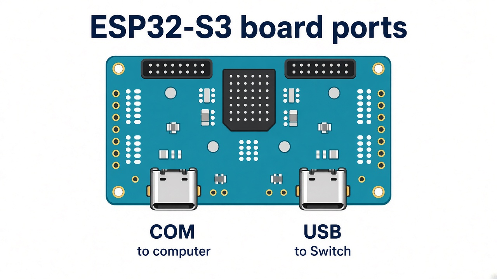
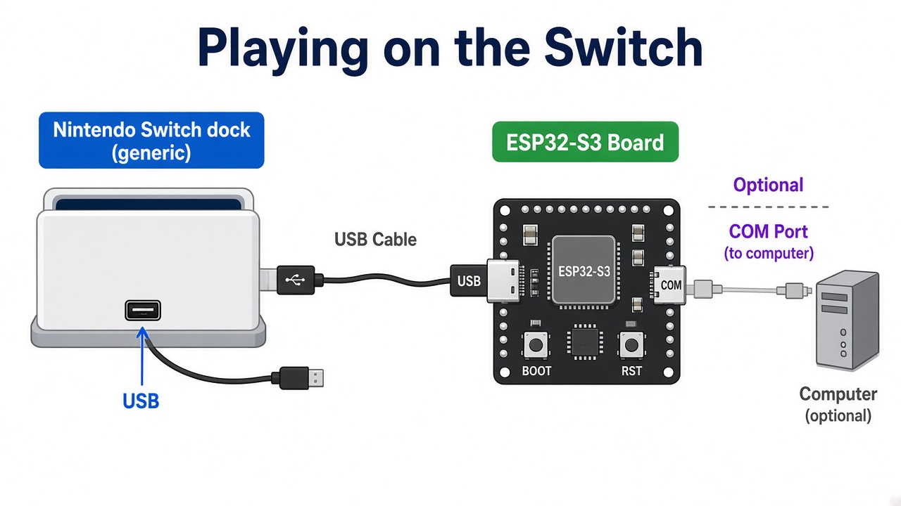

# ESP32-S3 → wired Nintendo Switch Pro Controller

Make a small **ESP32-S3** board act like a **wired USB Pro Controller** on a Nintendo Switch.

This is a beginner project. You clone it, load the program onto the board, plug it into the Switch, and check that it shows up.

> **Note:** This is for a Switch you own. It is a hobby USB controller project, not an official Nintendo product.

---

## Do I need an exact board?

**No.** Any **ESP32-S3** board is fine.

**Yes, it must say ESP32-S3.** A plain “ESP32” (no S3) will not work for this project.

**Best choice:** a board with **two USB ports** labeled **COM** and **USB**.



---

## What you need

- An **ESP32-S3** board (two USB ports preferred)
- A computer (**Windows**, **Mac**, or **Linux**)
- USB cables that transfer data (not charge-only)
- A Nintendo Switch (for the final check)
- Optional: a Switch dock (easiest USB port)

---

## Big picture

1. Install tools on your computer (one time)
2. Download this project
3. Plug **COM → computer** and load the program
4. Plug **USB → Switch**
5. Check that a Pro Controller appears

---

## Step 1 — Install the tools (one time only)

Pick your computer type.

### Windows

1. Install [Git for Windows](https://git-scm.com/download/win) if you don’t have it.
2. Open **PowerShell** and paste:

```powershell
winget install --id Espressif.EIM-CLI -e
```

3. Close PowerShell completely.
4. Open a **new** PowerShell and paste:

```powershell
eim install -n true -a true -t esp32s3 -i v5.5
```

5. Wait until it finishes. It can take a while. That is normal.

### Mac

1. Install [Homebrew](https://brew.sh/) if you don’t have it.
2. Open **Terminal** and paste:

```bash
brew install cmake ninja dfu-util
mkdir -p ~/esp
cd ~/esp
git clone -b v5.5 --recursive https://github.com/espressif/esp-idf.git
cd esp-idf
./install.sh esp32s3
```

### Linux

1. Open a terminal and paste:

```bash
sudo apt update
sudo apt install -y git wget flex bison gperf python3 python3-pip python3-venv cmake ninja-build ccache libffi-dev libssl-dev dfu-util libusb-1.0-0
mkdir -p ~/esp
cd ~/esp
git clone -b v5.5 --recursive https://github.com/espressif/esp-idf.git
cd esp-idf
./install.sh esp32s3
```

If you use Fedora or Arch, install similar packages with your package manager, then run the same `git clone` and `./install.sh esp32s3` steps.

---

## Step 2 — Download this project

```bash
git clone https://github.com/henryzlo/esp32-s3-usb-switch-pro.git
cd esp32-s3-usb-switch-pro
```

---

## Step 3 — Plug in for loading the program


| Board port | Plug into |
|------------|-----------|
| **COM** | Your computer |
| **USB** | Leave unplugged for now |

If your board only has one USB port, plug that into the computer for this step.

---

## Step 4 — Load the program onto the board

### Windows

```powershell
powershell -ExecutionPolicy Bypass -File .\flash.ps1
```

### Mac / Linux

```bash
chmod +x ./flash.sh
./flash.sh
```

If it asks which port to use:

- **Windows:** open Device Manager → **Ports (COM & LPT)**. Unplug and replug the cable. Use the COM number that appears (example: type `8` for COM8).
- **Mac:** choose something like `/dev/cu.usbserial-...`
- **Linux:** choose something like `/dev/ttyUSB0` or `/dev/ttyACM0`

When the script says it worked, the program is on the board.

---

## Step 5 — Plug into the Switch



| Board port | Plug into |
|------------|-----------|
| **USB** | Switch (dock USB is usually easiest) |
| **COM** | Optional — can stay on the computer |

**Important:** the port labeled **USB** goes to the Switch. The port labeled **COM** does **not**.

---

## Step 6 — Check that it works

### If you have a Switch

1. On the Switch go to **Controllers → Change Grip/Order**
2. Wait a few seconds
3. You should see a Pro Controller
4. The face buttons and left stick should move by themselves (demo mode)

That means it worked.

### If you do not have a Switch yet (PC check)

1. Plug the board port labeled **USB** into your computer
2. On Windows run:

```powershell
powershell -ExecutionPolicy Bypass -File .\test_pc.ps1
```

3. On Mac / Linux:

```bash
# Mac
system_profiler SPUSBDataType | grep -A2 -i nintendo

# Linux
lsusb | grep -i 057e
```

If your computer sees a Pro Controller, the board + program + USB cable are good.

---

## Something went wrong?

| Problem | What to try |
|---------|-------------|
| Script can’t find the tools | Finish Step 1, open a **new** terminal, try again |
| No port appears | Try another cable; make sure it is a data cable; try the other board port |
| Linux says permission denied | Unplug/replug, or add your user to the `dialout` group, then log out and back in |
| Switch doesn’t see a controller | Confirm **USB** (not COM) is in the Switch; try the dock; try another cable |
| Board acts weird after loading | Unplug both cables, plug only **USB → Switch**, try Change Grip/Order again |

---

## What this demo does

Right now the board presses buttons by itself so you can tell the Switch connection works.

Real physical buttons and sticks can be added later.

---

## License

MIT — see [LICENSE](LICENSE).
