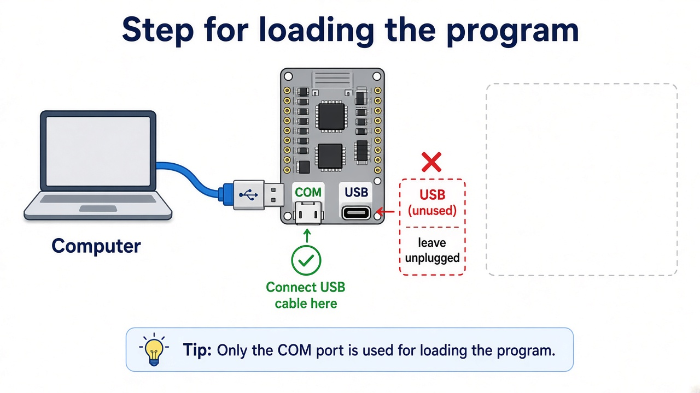

# ESP32-S3 → wired Nintendo Switch Pro Controller

Hobby project that makes an **ESP32-S3** show up as a wired USB Pro Controller on a Switch you own.

## Board

Any **ESP32-S3** works. Plain ESP32 (no S3) does not.

Prefer a board with two ports: **COM** and **USB**.


## What you need

- ESP32-S3 board
- Windows, Mac, or Linux computer
- Data USB cables
- Nintendo Switch (dock helps)

## 1. Install tools (one time)

### Windows

```powershell
winget install --id Espressif.EIM-CLI -e
```

Open a **new** PowerShell:

```powershell
eim install -n true -a true -t esp32s3 -i v5.5
```

### Mac

```bash
brew install cmake ninja dfu-util
mkdir -p ~/esp && cd ~/esp
git clone -b v5.5 --recursive https://github.com/espressif/esp-idf.git
cd esp-idf && ./install.sh esp32s3
```

### Linux

```bash
sudo apt update
sudo apt install -y git wget flex bison gperf python3 python3-pip python3-venv cmake ninja-build ccache libffi-dev libssl-dev dfu-util libusb-1.0-0
mkdir -p ~/esp && cd ~/esp
git clone -b v5.5 --recursive https://github.com/espressif/esp-idf.git
cd esp-idf && ./install.sh esp32s3
```

## 2. Clone

```bash
git clone https://github.com/henryzlo/esp32-s3-usb-switch-pro.git
cd esp32-s3-usb-switch-pro
```

## 3. Flash



Plug **COM → computer**. Leave **USB** unplugged.

**Windows**

```powershell
powershell -ExecutionPolicy Bypass -File .\flash.ps1
```

**Mac / Linux**

```bash
chmod +x ./flash.sh && ./flash.sh
```

If asked for a port: Windows Device Manager → Ports; Mac `/dev/cu.usbserial-*`; Linux `/dev/ttyUSB0` or `/dev/ttyACM0`.

## 4. Host commands (Liminal) + Switch


- Keep **COM → host** (Orange Pi / PC) for press commands — see [docs/host-protocol.md](docs/host-protocol.md).
- Plug **USB → Switch** (dock). Controllers → Change Grip/Order; enable Pro Controller Wired Communication.

Liminal discovers the COM port, completes the handshake, and sends button packets. Without a host, the controller stays neutral (no demo loop).

## 5. No Switch yet? PC check

Plug **USB → computer**, then:

**Windows**

```powershell
powershell -ExecutionPolicy Bypass -File .\test_pc.ps1
```

**Mac / Linux**

```bash
# Mac
system_profiler SPUSBDataType | grep -A2 -i nintendo
# Linux
lsusb | grep -i 057e
```

## Troubleshooting

| Problem | Try |
|---------|-----|
| Tools not found | Finish step 1, open a new terminal |
| No port | Data cable; try the other board port |
| Linux permission denied | Add user to `dialout`, log out/in |
| Switch sees nothing | Confirm USB (not COM); try dock/cable |

## License

MIT — see [LICENSE](LICENSE).
